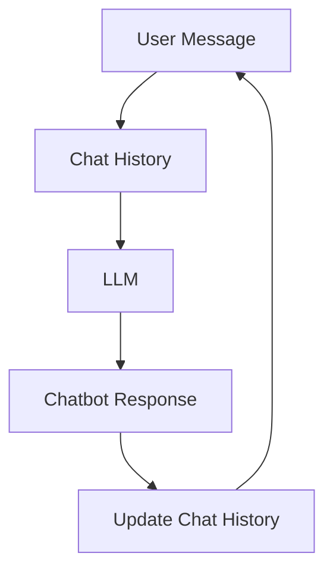

# Chatbot with Chat History

A simple conversational chatbot powered by a Large Language Model (LLM). It uses previous messages as conversation context to answer follow-up questions.

## Features

- LLM-powered chat responses
- Maintains conversation history
- Supports follow-up questions using previous messages
- Simple and easy-to-understand chatbot implementation

## How It Works
1. The user enters a message.
2. The message is added to the conversation history.
3. The conversation history is sent to the LLM.
4. The LLM generates a response based on the provided context.
5. The response is displayed and added to the conversation history.
6. The history can provide context for the next message.
## Flowchart



## Tech Stack

- Python
- Large Language Model (LLM)

## Installation and Usage

**1. Clone the repository**

```bash
git clone https://github.com/SAIRAJVEER/chatbot-with-chat-history.git
cd chatbot-with-chat-history
```

**2. Install dependencies**

```bash
pip install -r requirements.txt
```

**3. Configure your API key**

Set the API key required by your LLM provider. Keep your API key private and never upload it to GitHub.

**4. Run the chatbot**

```bash
python main.py
```

Replace `main.py` with your actual Python filename if it is different.

## Example

**User:** My favorite programming language is Python.

**User:** What is my favorite programming language?

**Chatbot:** Your favorite programming language is Python.

The chatbot can answer the follow-up question when the previous message is included in the conversation history sent to the LLM.

## Author

**Sai Rajveer**

GitHub: [SAIRAJVEER](https://github.com/SAIRAJVEER)
